<h3><code>rushanadv@github ~ $ ./contributions.sh</code></h3>

  

<h3><code>rushanadv@github ~ $ whoami</code></h3>
<table><tr>
  <td valign="top"></td>
  <td valign="top"></td>
</tr></table>

<h3><code>rushanadv@github ~ $ ./retrieval-trace.sh</code></h3>

 

<h3><code>rushanadv@github ~ $ ls ./featured</code></h3>
<table width="860">
  <tr>
    <td align="left" valign="top" width="430">
      <strong><a href="https://github.com/rushanadv/NyayLink">NyayLink</a></strong> — a legal services marketplace for India
        
      Next.js 15 · TypeScript · Supabase (Postgres + row-level security) Groq-powered AI legal intake role-based portals: client · advocate · admin 47 commits
    </td>
    <td align="left" valign="top" width="430">
      <strong><a href="https://hub.xerj.org/contributors/rushanadv">XERJ Corpus Hub</a></strong> — an open index of code that AI coding agents consult
        
      my code is indexed there: "Add new assets for DocsDrive World" DakshSingh-GitHub/docs-drive · 21 files · 1,495 lines TypeScript &amp; JavaScript · Apache-2.0 licence contributor since 2026-11-01
    </td>
  </tr>
</table>

<h3><code>rushanadv@github ~ $ ls ./badges</code></h3>

