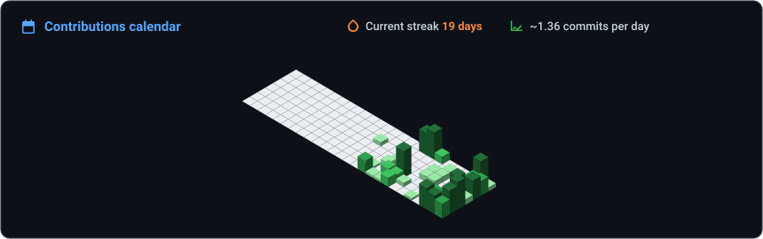
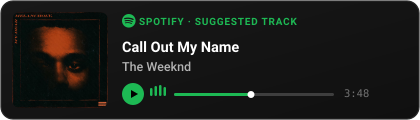
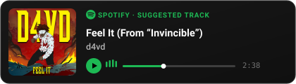

<h3><code>rushanadv@github ~ $ ./retrieval-trace.sh</code></h3>

 

<h3><code>rushanadv@github ~ $ ./contributions-calendar.sh</code></h3>

 

<h3><code>rushanadv@github ~ $ ./suggested-tracks.sh</code></h3>
<table width="860">
  <tr>
    <td align="center" width="430">
      
    </td>
    <td align="center" width="430">
      
    </td>
  </tr>
</table>
 

<h3><code>rushanadv@github ~ $ ls ./badges</code></h3>

